# 🏁 Enduro Horizon

A colorful 3D endurance racer inspired by Activision's **Enduro** (Atari 2600, 1983), rebuilt for the browser with Three.js. Like the original, you have to pass enough cars before the day ends, and the road keeps going through dawn, sunset, night and fog. Unlike the original, it has low-poly 3D worlds, a bloom-lit neon night, weather, and a synthwave soundtrack.

**▶ Play:** https://rschalch.github.io/enduro-horizon/

| | |
| --- | --- |
| 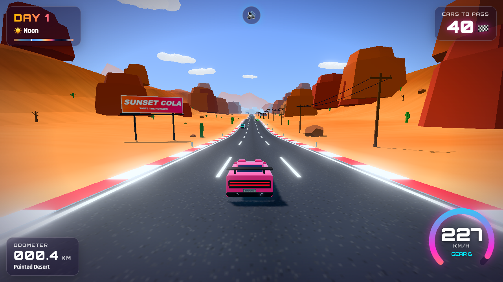 | 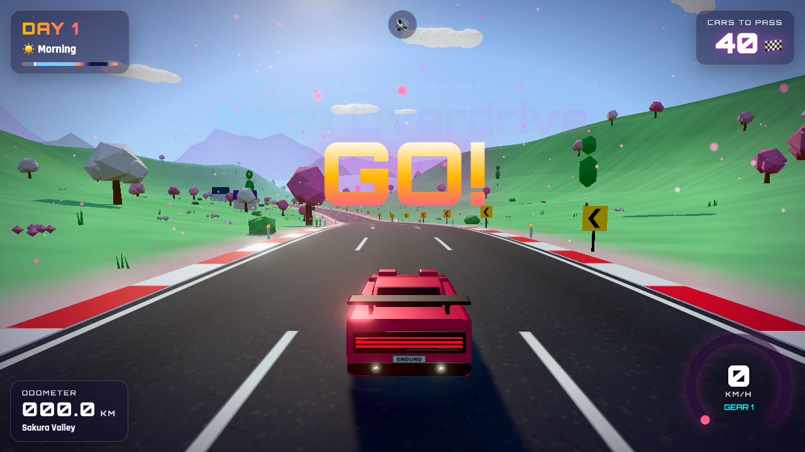 |
| 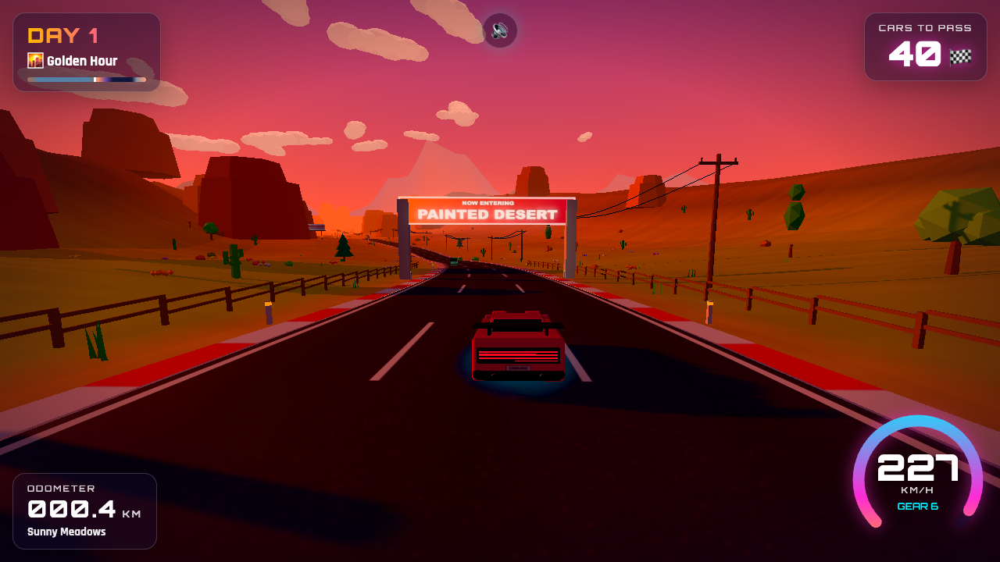 | 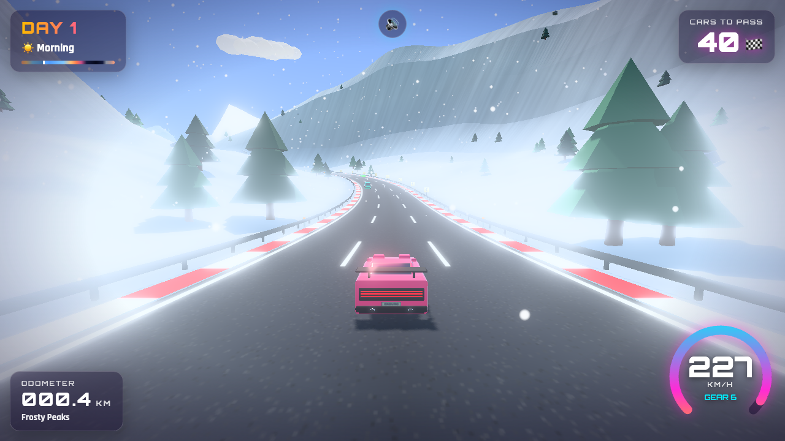 |
| 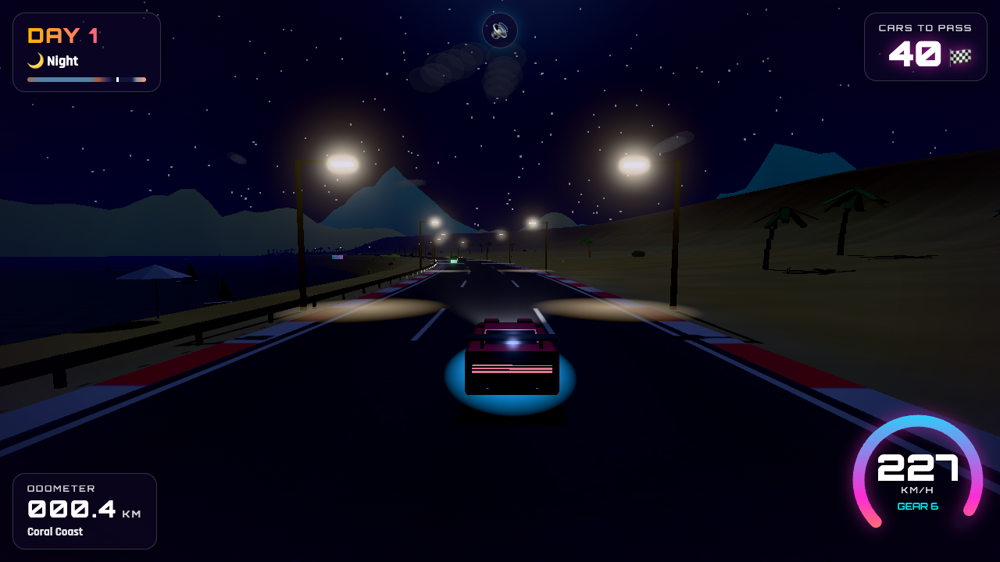 | 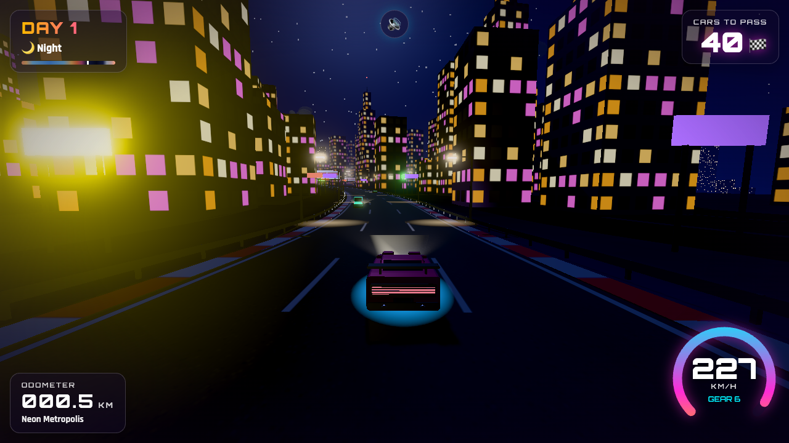 |

## Set pieces

The road is laid out in designed sections: S-bends, hairpins, sweepers, hill runs, climbs and straights, with banked curves. About every 2 km there's a set piece, announced by signs and an on-screen alert:

| | |
| --- | --- |
| 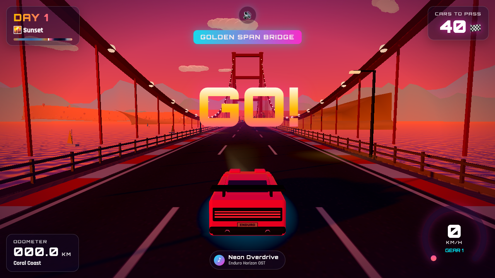 | 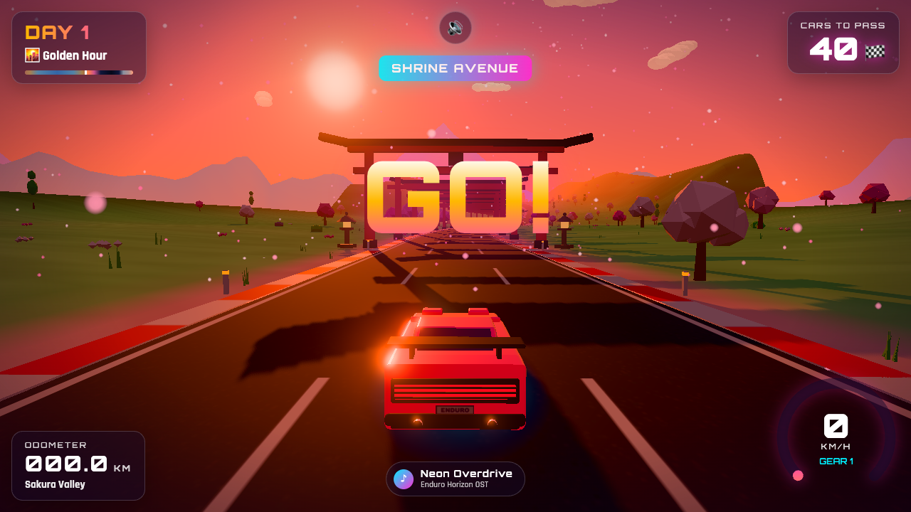 |
| 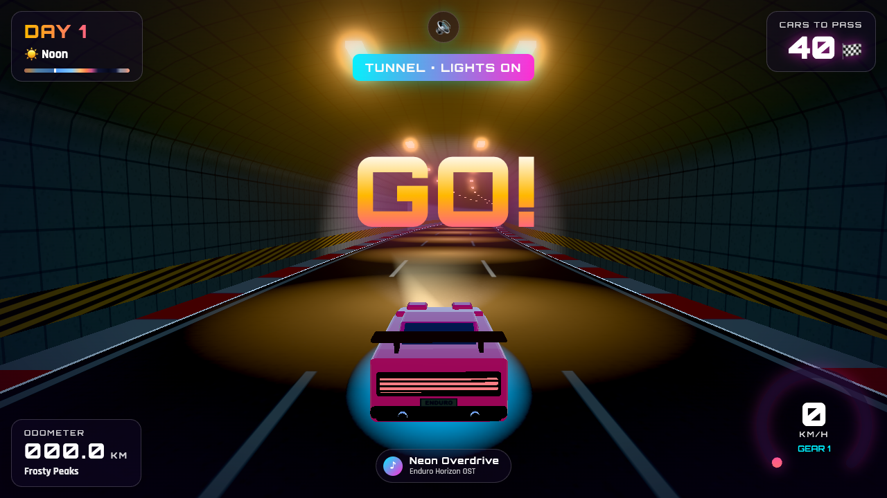 | 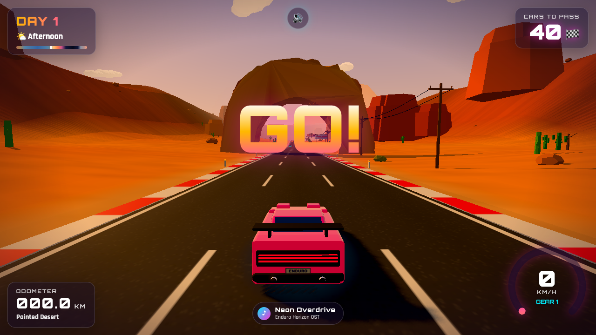 |
| 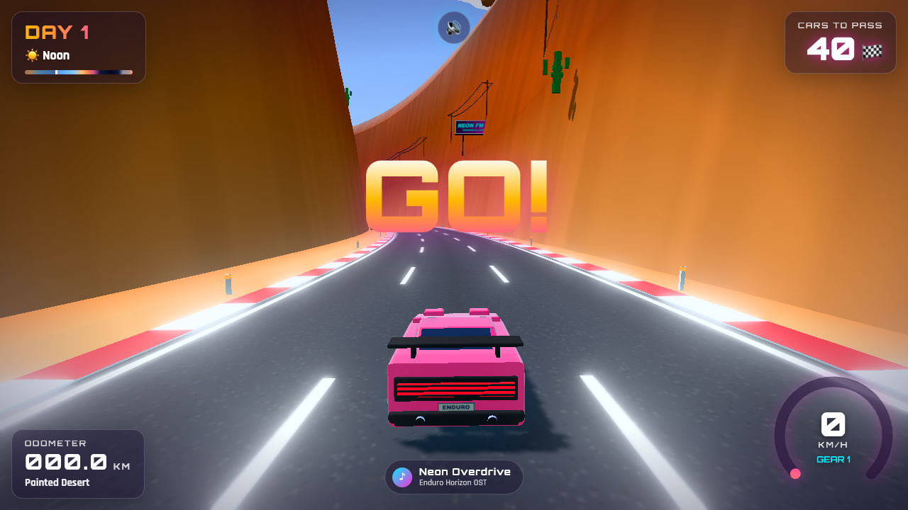 | 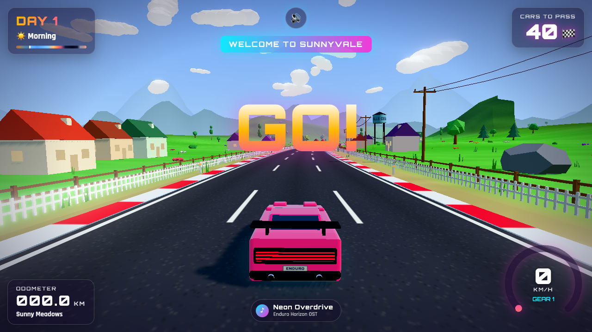 |

- **Tunnels:** rock, snow and neon. Headlights come on, the light drops and the engine echoes off the walls.
- **Bridges:** an orange suspension bridge on the coast, steel arch, truss and old stone viaducts over river valleys.
- **Canyon gorges and rock arches** in the desert.
- **Torii avenues** with stone lanterns in Sakura Valley.
- **Villages** with a church, a water tower and picket fences.
- **Highway overpasses** in the city.
- **Roadworks:** cones and a flashing arrow board close a lane. Traffic merges, and hitting the cones slows you down hard.

## Mountain passes

| | |
| --- | --- |
| 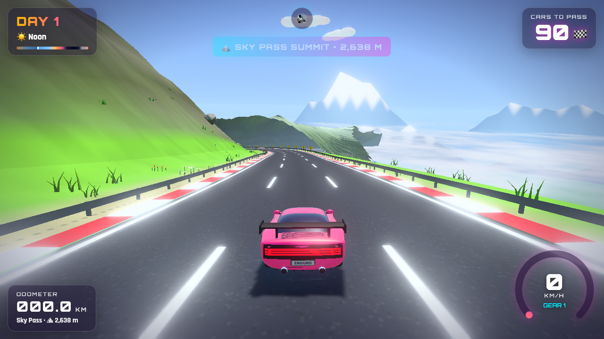 | 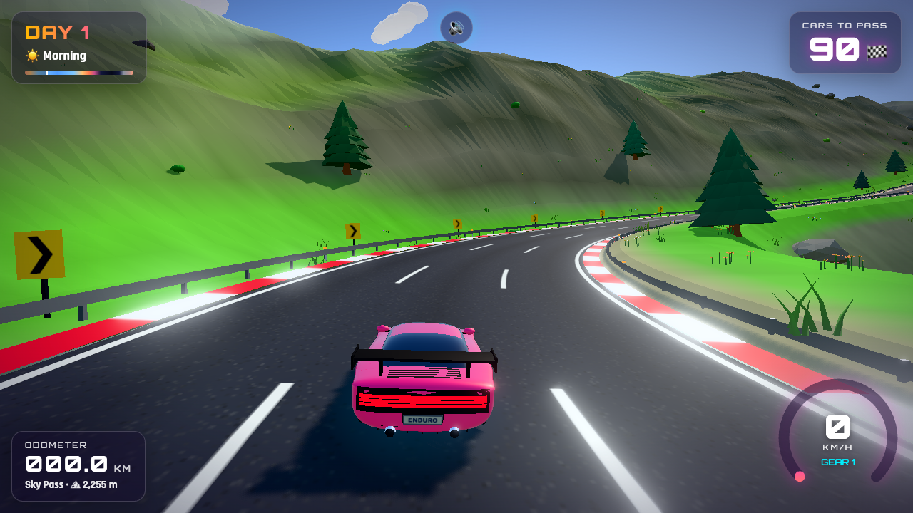 |

Two of the biomes are 10 km mountain passes. **Sky Pass** is green and summery, and **Frost Col** is covered in snow. Each one starts in the valley and climbs the valley wall, then up a stack of hairpin switchbacks (signposted, so brake). The road gains about 1,300 m of altitude, shown next to the biome name in the HUD. At the top there's a summit plateau with a gate, prayer flags, an alpine lake (frozen on Frost Col), cairns and a viewing deck. Across the drop, a sea of clouds hides the valley floor. Then the road heads down a long descent. Climbs slow you down, the lower slopes have pine forests, and higher up the slopes turn to alpine meadow, bare rock and snow.

## Weather and night sky

A day now lasts 8 minutes. Weather changes as you drive, with odds that depend on the biome:

| | |
| --- | --- |
| 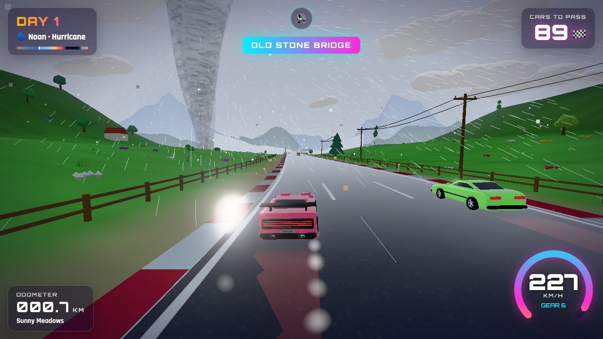 | 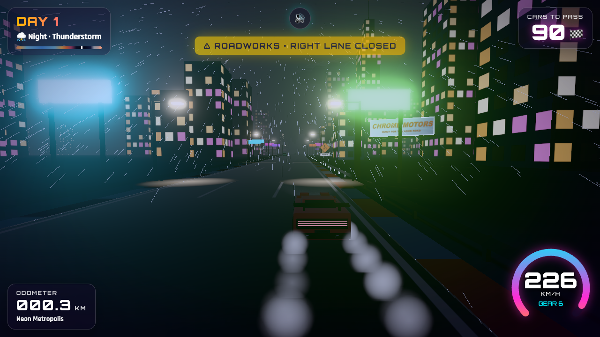 |
| 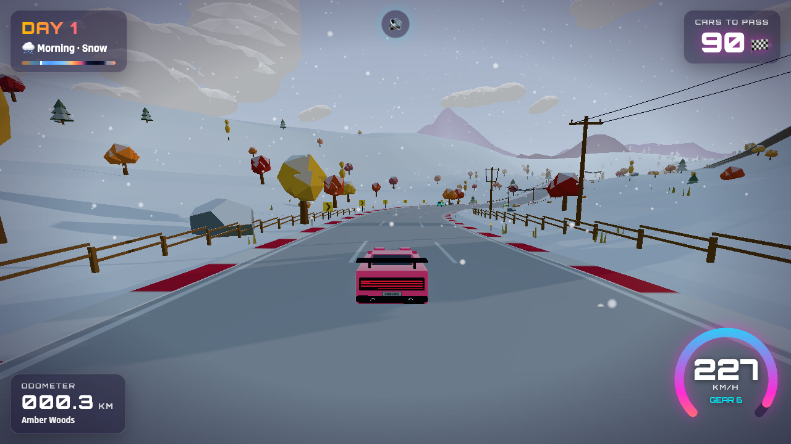 | 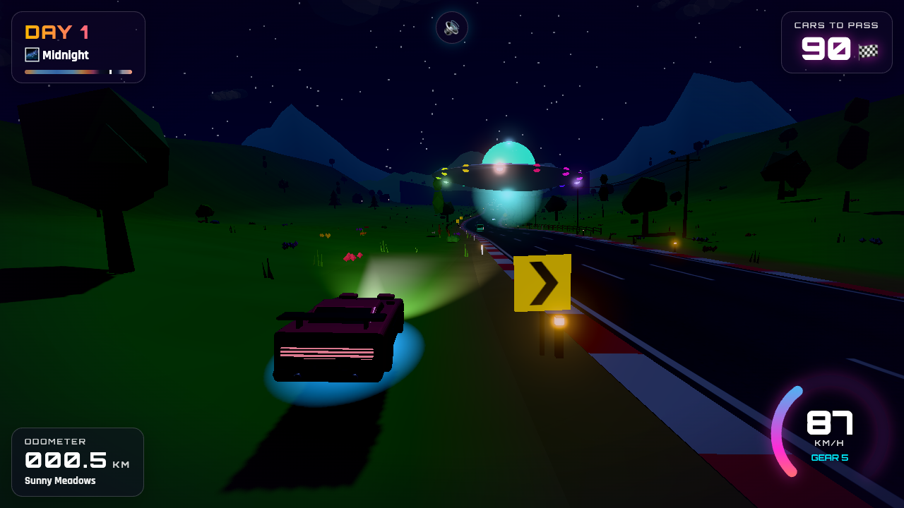 |

- **Rain and thunderstorms:** slanted rain, an overcast sky, wet glossy asphalt that reflects taillights and lamps, tire spray, lightning with delayed thunder, rain sound, and less grip.
- **Hurricanes:** near-horizontal rain, gusts that shove the car sideways, bending trees and palms, flying debris, a howling gale, rough seas and twisters crossing the horizon.
- **Snow and blizzards:** snow settles on the ground, trees, roofs and the road. Fog thickens and grip drops.
- **Clear nights:**
  - shooting stars, meteor showers and fireballs that crash beyond the horizon with a distant boom
  - every so often, a UFO: it beams up a cow, buzzes your car (flickering headlights, radio static) and then shoots off into space

Debug: `?weather=clear|cloudy|rain|storm|hurricane|snow|blizzard`, `?ufo` (a UFO arrives within seconds at night), `?meteors` (4× more meteors).

## How to play

| Action | Keyboard | Gamepad | Touch |
| --- | --- | --- | --- |
| Accelerate | `↑` / `W` / `Space` | RT / A | ▲ |
| Brake | `↓` / `S` | LT / B | ■ |
| Steer | `←` `→` / `A` `D` | Left stick / D-pad | ◀ ▶ |
| Pause | `P` / `Esc` | Start | — |
| Music on/off | `M` | — | — |
| Next song | `N` | — | — |
| Sound settings (volumes, mute) | `O` or the 🔊 button | — | 🔊 button |
| Fast/Fancy graphics | `Q` | — | — |

- Each **day** lasts about 8 minutes. Pass the number of cars shown in the top-right before dawn, or the race ends.
- Cars that overtake you put the counter back up, like in the original.
- Hitting a car from behind costs you most of your speed. Driving off the road slows you down.
- Snow in **Frosty Peaks** reduces grip. Fog and night reduce how far you can see.

## Sound

All sound is synthesized live in the browser; there are no audio files.

- **Engine:** a V8 model with gear ratios and an automatic gearbox (shift cut and blip), uneven-firing burble, intake roar, exhaust crackle when you lift off, tire squeal in hard corners and under braking, gravel rumble off-road, wind, and a whoosh when you pass a car.
- **Soundtrack:** three original 80s synthwave songs, each with intro, verse, chorus, breakdown and fills:
  - *Neon Overdrive*: A minor, 118 BPM
  - *Midnight Coastline*: E minor, 100 BPM
  - *Turbo Sunset*: D major, 128 BPM

  Instruments include gated-reverb snares, a Moroder-style bass, Juno-style pads, FM bells and e-piano, brass stabs and a lead with vibrato.
- **Sound panel:** volume sliders for Master, Music, Effects and Engine, plus mute and song skip. Your settings are saved.

## The world

The track is generated as you drive and never ends. Every ~5 km (10 km for the passes) it passes through a new biome, marked by a gate:

1. **Sunny Meadows**: rolling green hills, flowers, hot-air balloons
2. **Sky Pass** (s=5000): a mountain pass with switchbacks, a summit lake and a sea of clouds
3. **Painted Desert**: orange dunes, mesas, cacti, long sweeping curves
4. **Coral Coast**: beach on one side, ocean and sailboats on the other, palm-lined boulevard with street lamps
5. **Sakura Valley**: pink cherry trees and drifting petals
6. **Frosty Peaks** (s=30000): the Frost Col pass, with snow walls, pines, snowfall, a frozen summit lake and slippery hairpins
7. **Amber Woods**: autumn forest with falling leaves
8. **Neon Metropolis**: towers with lit windows, neon signs, a city skyline glowing at night

Each biome sets its own colors, terrain shape, curve tightness, rolling hills (crests hide the traffic ahead), grip, fog and weather, and neighboring biomes blend into each other. Along the road you'll find farmhouses, wind turbines, fences, power lines, guardrails, curve chevrons, 80s billboards, beach umbrellas and sailboats, mountain cabins and skyscrapers with rooftop beacons. Time of day runs on its own cycle (Dawn → Sunrise → Morning → Noon → Afternoon → Golden Hour → Sunset → Blue Hour → Night → Midnight → Fog). Each phase has its own light, fog and color grading, and at night you get street-lamp light on the road, lit windows, headlight beams and blinking beacons, so you see each place in different light from one run to the next.

## Running locally

```bash
npm install
npm run dev       # http://localhost:5173
npm run build     # static build in dist/
```

Debug URL parameters: `?autostart` skips the title screen, `?s=9500` starts at a given distance in meters (e.g. at the Sky Pass summit with `seed=12345`), `?t=0.75` sets the time of day (0–1), and `?seed=123` gives a repeatable track.

## Code tour

| File | What it does |
| --- | --- |
| `src/track.js` | Section planner (curves, hairpins, hills, set pieces, mountain passes), banking, biome blending, sea level |
| `src/features.js` | Set-piece models: tunnels, bridges, arches, torii, overpasses, roadworks, villages, signs |
| `src/biomes.js` | Data for the eight biomes: palettes, terrain, props, weather, grip, passes |
| `src/world.js` | Streams 100 m chunks: road, kerbs, terrain strips, instanced props, biome gates, mountain-pass terrain |
| `src/summit.js` | Pass summits: alpine lake, prayer flags, cairns, viewing deck |
| `src/props.js` | Low-poly scenery models (trees, cacti, mesas, palms, buildings, lamps…) |
| `src/sky.js` | Sky shader, sun/moon, stars, clouds, mountain/skyline rings, ocean, lights and fog |
| `src/timeofday.js` | Day-cycle keyframes and sun/moon paths |
| `src/cars.js` / `src/traffic.js` | Rounded car models with real wheels (player 80s wedge, coupe, sedan, hatchback, van, pickup, semi); rival AI |
| `src/weather.js` | Snow, petals and leaves |
| `src/climate.js` | Weather system: rain, storms, hurricanes, twisters, snow cover, wind sway, spray |
| `src/skyevents.js` | Shooting stars, fireballs and UFOs |
| `src/audio.js` | Synthesized engine, tires, wind and effects |
| `src/music.js` | 80s soundtrack: songs, instruments and a real-time sequencer |
| `src/settings.js` | Sound settings panel |
| `src/main.js` | Game loop, player physics, collisions, day rules, camera |

Everything is drawn in code: there are no image or audio files to download.

## Ideas for what's next

- **Rival personalities**: trucks that drift between lanes, sports cars that fight back when you pass, police chases at night.
- **Weather events**: rain with wet-road reflections and windshield drops, sandstorms in the desert, an aurora over Frosty Peaks.
- **Boost and drafting**: tuck in behind a car to charge a nitro meter.
- **Seasons**: the same biome could look different on each new day (spring, summer, autumn, winter).
- **Landmarks**: a lighthouse on the coast, a ski jump, a stadium in the city, a volcano.
- **Garage**: unlock paint jobs, underglow colors and car bodies by reaching later days.
- **Daily seed challenge** with a shared leaderboard, and ghost replays of your best run.
- **Photo mode** with free camera and filters.
- **Better mobile controls**: tilt steering and auto-throttle.

## License

MIT. Inspired by *Enduro* © Activision 1983; this is a fan homage with original code and assets.
