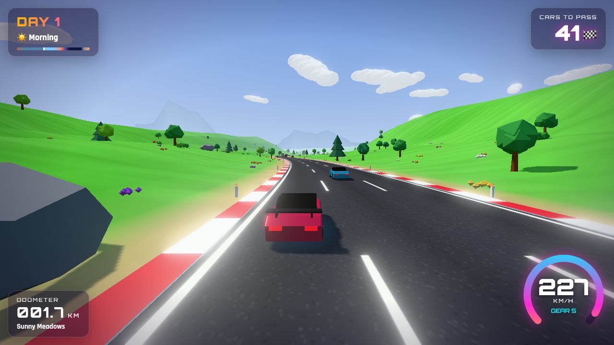
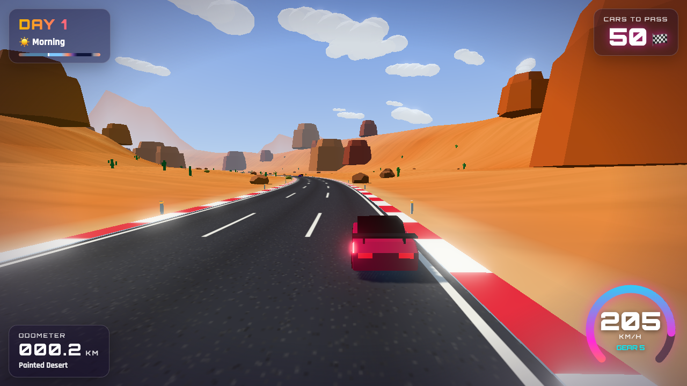
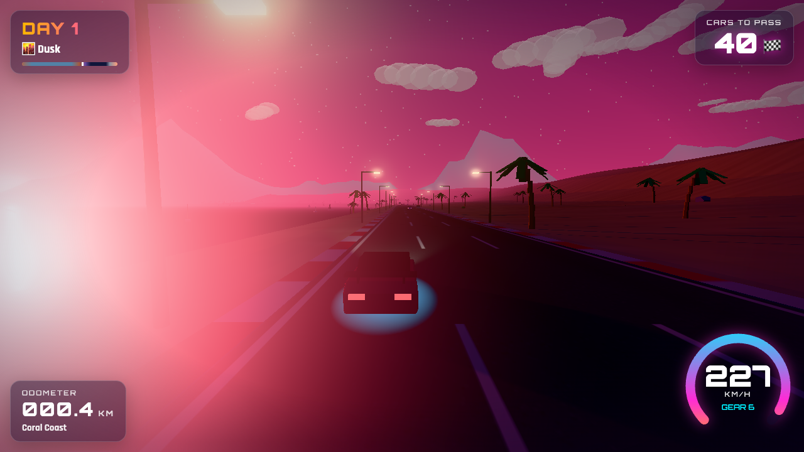
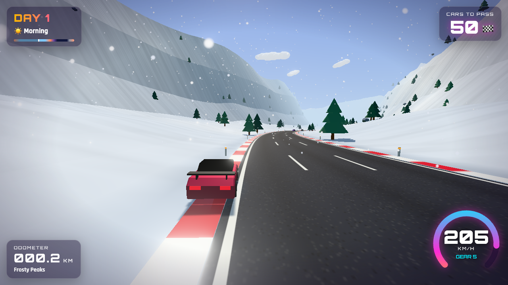
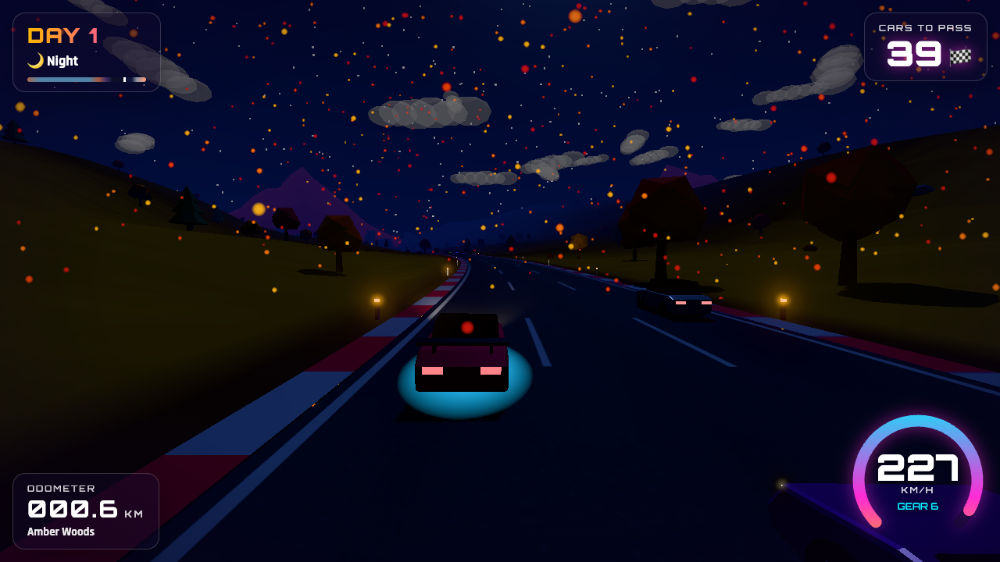
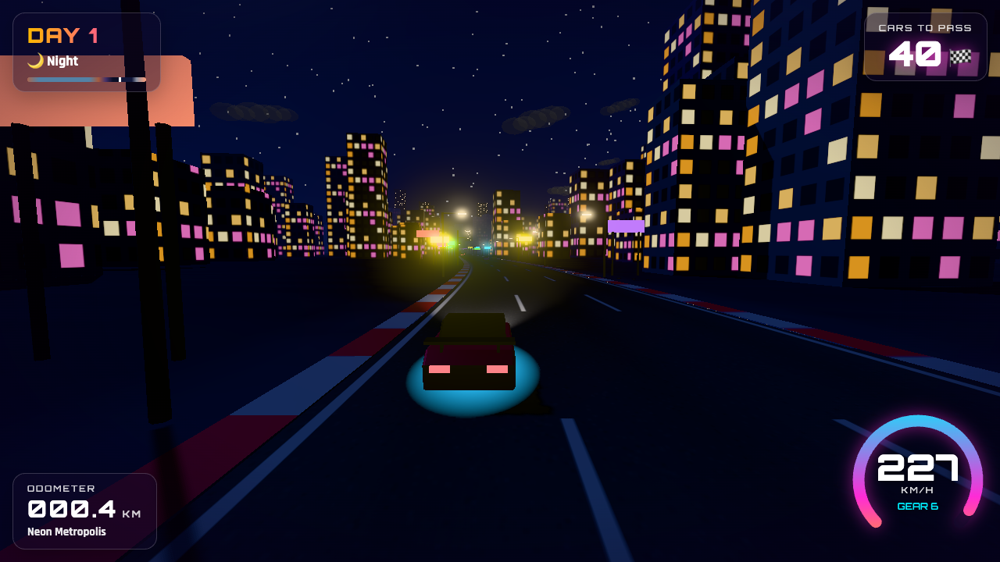

# 🏁 Enduro Horizon

A colorful 3D endurance racer inspired by Activision's **Enduro** (Atari 2600, 1983), rebuilt for the browser with Three.js. Like the original, you have to pass enough cars before the day ends, and the road keeps going through dawn, sunset, night and fog. Unlike the original, it has low-poly 3D worlds, a bloom-lit neon night, weather, and a synthwave soundtrack.

**▶ Play:** https://rschalch.github.io/enduro-horizon/

| | |
| --- | --- |
|  |  |
|  |  |
|  |  |

## How to play

| Action | Keyboard | Gamepad | Touch |
| --- | --- | --- | --- |
| Accelerate | `↑` / `W` / `Space` | RT / A | ▲ |
| Brake | `↓` / `S` | LT / B | ■ |
| Steer | `←` `→` / `A` `D` | Left stick / D-pad | ◀ ▶ |
| Pause | `P` / `Esc` | Start | — |
| Music on/off | `M` | — | — |
| Fast/Fancy graphics | `Q` | — | — |

- Each **day** lasts about 3½ minutes. Pass the number of cars shown in the top-right before dawn, or the race ends.
- Cars that overtake you put the counter back up, like in the original.
- Hitting a car from behind costs you most of your speed. Driving off the road slows you down.
- Snow in **Frosty Peaks** reduces grip. Fog and night reduce how far you can see.

## The world

The track is generated as you drive and never ends. Every ~5 km it passes through a new biome, marked by a gate:

1. **Sunny Meadows**: rolling green hills, flowers, hot-air balloons
2. **Painted Desert**: orange dunes, mesas, cacti, long sweeping curves
3. **Coral Coast**: beach on one side, ocean and sailboats on the other, palm-lined boulevard with street lamps
4. **Sakura Valley**: pink cherry trees and drifting petals
5. **Frosty Peaks**: snow walls, pines, snowfall, slippery tight turns, steep grades
6. **Amber Woods**: autumn forest with falling leaves
7. **Neon Metropolis**: towers with lit windows, neon signs, a city skyline glowing at night

Each biome sets its own colors, terrain shape, curve tightness, hills, grip, fog and weather, and neighboring biomes blend into each other. Time of day runs on its own cycle (Dawn → Morning → Afternoon → Sunset → Dusk → Night → Fog), so you see each place in different light from one run to the next.

## Running locally

```bash
npm install
npm run dev       # http://localhost:5173
npm run build     # static build in dist/
```

Debug URL parameters: `?autostart` skips the title screen, `?s=21000` starts at a given distance in meters (e.g. inside Frosty Peaks), `?t=0.75` sets the time of day (0–1), and `?seed=123` gives a repeatable track.

## Code tour

| File | What it does |
| --- | --- |
| `src/track.js` | Endless procedural center line (curvature/grade random walk), biome blending, sea level |
| `src/biomes.js` | Data for the seven biomes: palettes, terrain, props, weather, grip |
| `src/world.js` | Streams 100 m chunks: road, kerbs, terrain strips, instanced props, biome gates |
| `src/props.js` | Low-poly scenery models (trees, cacti, mesas, palms, buildings, lamps…) |
| `src/sky.js` | Sky shader, sun/moon, stars, clouds, mountain/skyline rings, ocean, lights and fog |
| `src/timeofday.js` | Day-cycle keyframes and sun/moon paths |
| `src/cars.js` / `src/traffic.js` | Car models; rival AI with lane changes and following |
| `src/weather.js` | Snow, petals and leaves |
| `src/audio.js` | Synthesized engine, effects and a real-time synthwave sequencer |
| `src/main.js` | Game loop, player physics, collisions, day rules, camera |

Everything is drawn in code: there are no image or audio files to download.

## Ideas for what's next

- **Rival personalities**: trucks that drift between lanes, sports cars that fight back when you pass, police chases at night.
- **Weather events**: rain with wet-road reflections and windshield drops, sandstorms in the desert, an aurora over Frosty Peaks.
- **Boost and drafting**: tuck in behind a car to charge a nitro meter.
- **Seasons**: the same biome could look different on each new day (spring, summer, autumn, winter).
- **Landmarks**: a lighthouse on the coast, a ski jump, a stadium in the city, a volcano.
- **Garage**: unlock paint jobs, underglow colors and car bodies by reaching later days.
- **Daily seed challenge** with a shared leaderboard, and ghost replays of your best run.
- **Photo mode** with free camera and filters.
- **Better mobile controls**: tilt steering and auto-throttle.

## License

MIT. Inspired by *Enduro* © Activision 1983; this is a fan homage with original code and assets.
